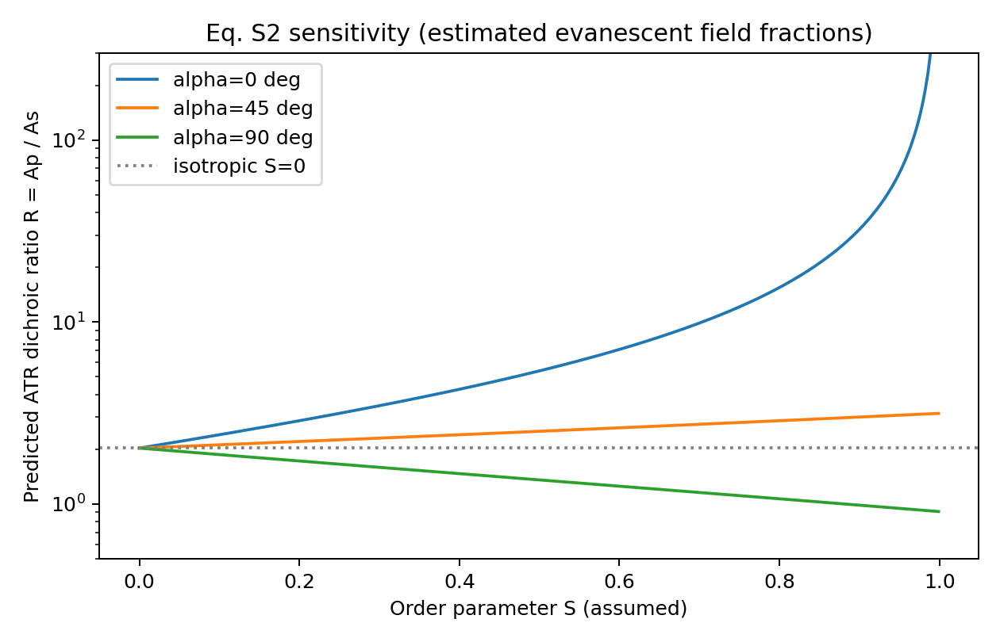
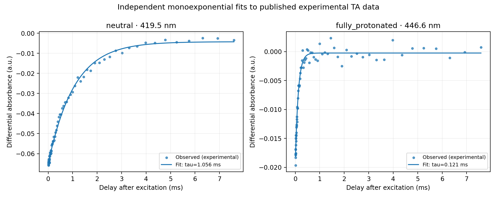

# MOF Spectra AutoLab

**Reproducible Python research prototype for spectroscopy analysis, virtual flow-cell acquisition, and simulated Bayesian experimental design.**

> **Evidence boundary:** Real, published time-resolved porphyrin spectroscopy was used for single-wavelength lifetime reproduction; a published MOF thin-film study was used for analytical polarized ATR-FTIR orientation calculations. The Bayesian optimization and flow-cell system are **simulations**. No MOF synthesis, physical instrument control, or extraction of measured MOF film orientation has been performed.

## Results at a glance

| Workstream | Evidence | Result / status |
|---|---|---|
| Transient absorption of TCPP (Prins et al., 2024) | External measured spectra supplied separately | Single-exponential lifetimes 1.056 ms (no MSA) and 0.1206 ms (1024 mM MSA), conditional on wavelength, fitting window and time-unit assumption; reference ~1.2 ms and ~0.120 ms |
| MOF polarized ATR-FTIR orientation (Baumgartner et al., 2021) | Published analytical Eq. S2 and field factors | R=2.03 for S=0; R=0.909 for S=1, α=90°; R approaches infinity for S=1, α=0°. **These are model outputs, not measured MOF spectra.** |
| MOF layer-by-layer film geometry | Published 10.8 Å per layer | 40 × 1.08 nm = 43.2 nm vs paper's approximate 50 nm film thickness; a geometric check, not measured growth rate |
| Bayesian next-experiment selection | Fully synthetic response surface | In a 30-run toy benchmark, mean best scores 1.551 vs 1.395 for uniform random search; no experimental validation |
| Dryad UV–Vis P-4/D-4 | Published non-MOF pyrimidone thin-film spectra | Descriptive spectral extraction and synthetic-endmember unmixing sensitivity test; not independent mixture experiments |

## Visual results




## Quick start

Python 3.10+ (CPU only):

```bash
python3 -m venv .venv
source .venv/bin/activate
pip install -r requirements.txt
python -m pytest -q tests/
python src/mof_orientation.py --output results/mof_orientation
python src/validation.py --runs 30 --steps 12 --bootstrap-samples 2000 --output results
```

External data-dependent commands require the source files to be downloaded separately:

```bash
# Place the published Dryad CSV under data/published_uvvis/
python src/published_uvvis_analysis.py
# Provide the original Baumgartner data ZIP acquired from the authors' deposit
python src/published_lifetime_reproduction.py --source-zip "/path/to/data upload.zip" --out results/baumgartner_lifetimes --bootstrap 500
```

Tests requiring the Dryad CSV are **skipped** until the file is supplied. CI checks the data-independent modules. The published porphyrin ZIP and journal supplementary PDF are deliberately not redistributed. `results/` contains documented outputs generated in the earlier local research workflow; their existence alone does not demonstrate experimental acquisition by this project.

## Scope and key limitations

- **Experimental:** reanalysis of two previously published porphyrin photochemical traces, not independently generated measurements; reproduces descriptive lifetimes, not a multistate global kinetic mechanism.
- **Analytical reproduction:** MOF orientation from a cited equation and assumed ATR field fractions, not inversion of measured FTIR amplitudes.
- **Simulation:** virtual flow instrument, noise model, synthetic two-polarization growth spectra, closed-loop Bayesian optimization; none represent verified physical MOF growth.
- The Dryad pyrimidone and porphyrin systems must not be labeled as MOF experiments.
- A few Gaussian-process numerical convergence warnings may occur; see detailed development notes.

## Original sources and credit

1. Baumgartner, B. et al. *Infrared Crystallography for Framework and Linker Orientation in Metal-Organic Framework Films*, Chemical Science (2021), DOI: https://doi.org/10.1039/D1SC02370E . Supporting information supplies Eq. S2, ATR field fractions and film geometry.
2. Prins et al. *Porphyrins on acid: kinetics of the photoinduced-protonation of tetrakis(4-carboxyphenyl)-porphyrin*, PCCP (2024), DOI: https://doi.org/10.1039/D4CP02542C . External experiment and reference lifetime values.
3. Nguyen et al., *Molecular solar thermal energy storage in Dewar Pyrimidone beyond 1.6 MJ/kg*, Dryad (2026), DOI: https://doi.org/10.5061/dryad.rxwdbrvqg . Non-MOF thin-film UV–Vis data.

Software code is MIT-licensed. Third-party publications and datasets retain their own terms; review those sources before redistribution.

For detailed implementation and experiment history, see [Development history](docs/DEVELOPMENT_HISTORY.md). See `src/`, `tests/`, and `results/` for the corresponding scripts, tests, and saved outputs.
